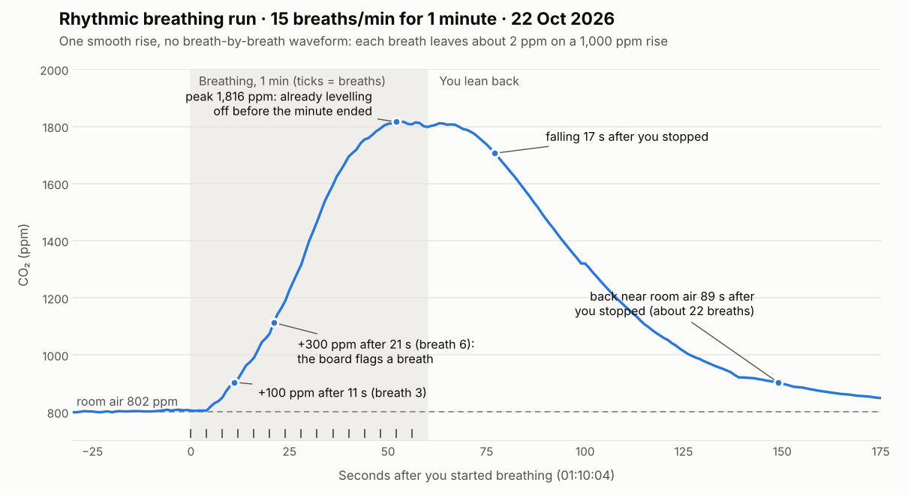
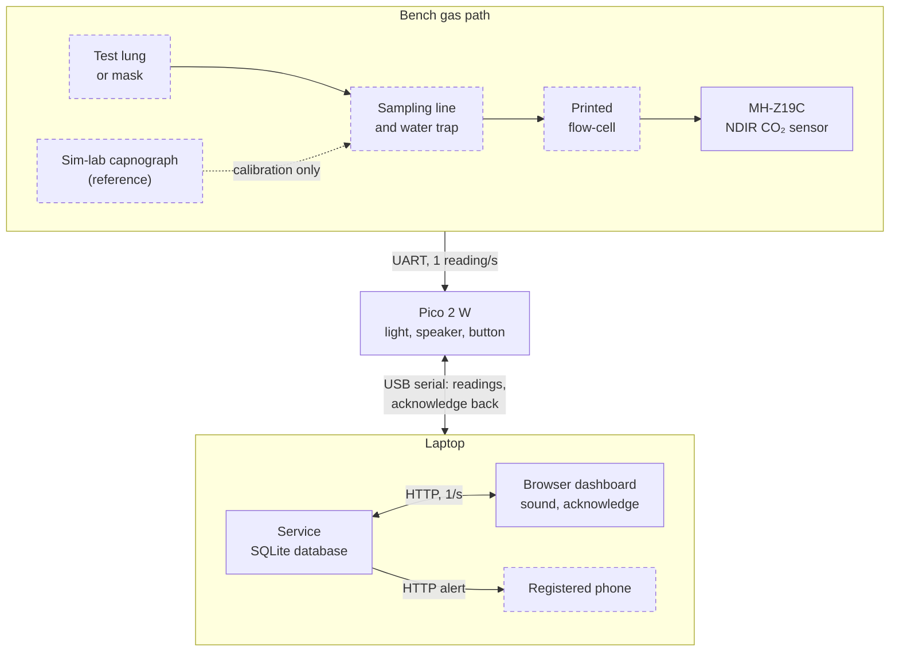

# Project 6: Is the Patient Ventilating?

**Exhaled CO₂ and hypoventilation monitor (bench prototype)**  
EXSU 620 Surgical Innovation · Digital Prototyping · McGill University · Fall 2026

[](https://github.com/azouzkm/CO2-Hypoventilation-Monitor/actions/workflows/tests.yml)

Sample airway gas → confirm exhaled CO₂ → derive breathing rate from the signal → four-state alarm,
while **measuring and honestly reporting its own response time**, rather than pretending to be a
breath-by-breath capnograph.

> [!IMPORTANT]
> **What the bench shows so far:** this sensor supports a **breath-averaged trend, not
> breath-by-breath capnography**. On 22 Oct 2026 it took 11–13 s to rise and about a minute to fall
> after a breath, and breathing at 15 breaths/min left only about 2 ppm of ripple per breath on a
> 1,000 ppm rise. Everything here is designed, tested and reported on that basis.

> [!WARNING]
> **Bench only.** Nothing built here goes near a patient or clinical equipment in service. No
> patient-identifiable information goes into the database, this repository or any message. The
> simulation-lab capnograph is a calibration and validation reference only, never a live channel
> during a logging run.

## Members

- Abdelaziz Mourad
- Nyah Woller-li
- Szirina Ismail
- Alice She
- Michele Frederike
- Yuhan Zhang

## Where things stand (1 Nov 2026)

| Part | State |
| --- | --- |
| CO₂ sensor | Winsen MH-Z19C (NDIR, 400–5,000 ppm, UART) reading reliably since 22 Oct; wiring and supply checked |
| Printed parts | Flow-cell v1 (taped, leak-tested) and the Option A case: everything sits in the case since 1 Nov, the sampling line pushes onto SAMPLE from outside. **Open: air through the cell.** Without a pump, breath does not reliably reach the sensor, and a cell full of old breath reads 5,000 ppm (1 Nov) |
| Firmware | **v0.6 on the board (1 Nov):** CR-1 (CO₂ present/absent), the four alarm states, CR-4 breathing rate and ADVISORY, the CR-3 safety clip (tube off = TECHNICAL "LINE OFF" in about 1 s, tested at the bench), a reading stuck at 5,000 ppm = TECHNICAL, and the JSON link to the dashboard |
| Light ring, speaker, button | Wired and working. The speaker is driven straight from the pin through a resistor (quiet): the amplifier, tried unsoldered on 26 Oct, needs its pins soldered (one pin made no contact) |
| Service, database, dashboard | **Built 26 Oct:** `bash tools/dashboard.sh` shows the box's state live in the browser, with the same light and sounds, acknowledge with initials (sent to the box), a Technical alarm when data stops, the CO₂ trend and the alarm log, all saved in SQLite. Tested on the recorded 25 Oct alarm test; first live try with the board next |
| Messages to phones | **Built 27 Oct:** a sign-up page (WhatsApp, Signal or Telegram through CallMeBot, consent time stored) and the messages of workshop slide 11: Critical at once and again at 2 minutes if nobody acknowledges, Advisory and Technical after a minute, with retries, and failures shown on the dashboard. Tested with a stand-in for CallMeBot; first real message next |
| Bench tools | Dashboard, live view, and scripted CR-1 runs with spoken cues, scored against ER-1 and ER-2 |
| Tests | 88 firmware tests, plus the service and phone-message tests, run by GitHub on every pull request |

Session-by-session record: [docs/lab-notebook.md](docs/lab-notebook.md).

## Requirements and deliverables

Traceability decides most of the marks: every engineering requirement (ER) names the clinical
requirement (CR) it serves, and every verification result names the ER it closes.

| CR | Clinical requirement (project card) | Progress |
| --- | --- | --- |
| CR&#8209;1 | Presence or absence of exhaled CO₂ confirmed within a stated number of breaths and displayed unambiguously | ER-1 (present within 3 breaths) and ER-2 (absent within 30 s) drafted and built into the firmware (v0.4 on the board), shown on the box and, since 26 Oct, on the dashboard; the flow-cell is printed and sealed, and the counted verification runs wait on airflow through it |
| CR&#8209;2 | Loss of CO₂ while the circuit reads connected raises an immediate alarm | Critical alarm (red, 10 pulses, latched until the button) built and tried at the bench on 25 Oct, and mirrored on the dashboard with its sound and acknowledge, and messaged to phones at once (again at 2 minutes if nobody acknowledges); ERs to draft; "circuit connected" needs the break-wire loop |
| CR&#8209;3 | A blocked or disconnected sampling line is reported as a fault and never presents as apnoea | Sensor faults (no answer, stuck at 400, impossible jumps) raise Technical, never Critical: tried at the bench with a pulled data wire, and replayed on the 22 Oct glitches; a lost USB link is Technical on the dashboard too; a disconnected line: safety clip built and tested 1 Nov (TECHNICAL "LINE OFF" in about 1 s, never CRITICAL); a blocked line needs airflow or a water-trap probe; ERs to draft |
| CR&#8209;4 | Breathing rate from the CO₂ signal recorded through the procedure, with alarms on a sustained fall | ER-7 and ER-8 drafted; rate and ADVISORY in firmware v0.6; bench runs need airflow (`tools/rate_run.sh`) |

| | Deliverable | Marks | Where it lives |
| --- | --- | --- | --- |
| D1 | Engineering requirements | 10 | [docs/D1-engineering-requirements.md](docs/D1-engineering-requirements.md) (draft) |
| D2 | System design | 5 | `docs/D2-system-design.md` (to write) |
| D3 | Component, module and system chart | 10 | `docs/D3-components-interfaces.md` (to write) |
| D4 | System diagram set | 5 | `docs/diagrams/` (to draw) |
| D5 | Working system and documentation | 35 | [firmware/](firmware/), [service/](service/), [dashboard/](dashboard/), [hardware/](hardware/), [tools/](tools/) and this README |
| D6 | Verification plan | 5 | [docs/D6-verification-plan.md](docs/D6-verification-plan.md) (draft, CR-1 first) |
| D7 | Verification report | 10 | `docs/D7-verification-report.md` (to write), with the evidence in [data/](data/) |
| D8 | Failure modes and mitigation | 10 | `docs/D8-failure-modes.md` (to write); candidates in the [lab notebook](docs/lab-notebook.md) |
| D9 | Design dossier (one PDF) | 10 | [docs/D9-dossier/](docs/D9-dossier/) (outline) |

Progress and the order of work: [docs/deliverables.md](docs/deliverables.md).

## Response time, measured

The project card asks the device to measure and publish its own response time. First numbers, in
open air about 15 cm from the sensor, before the flow-cell and sampling line exist:

| Test (22 Oct 2026) | Rise 10–90 % | Fall 90–10 % | Back near room air |
| --- | --- | --- | --- |
| Single breath 1 | 12.7 s | 51 s | 81 s |
| Single breath 2 | 10.6 s | 66 s | 93 s |
| 15 breaths/min for 1 min | 31 s (whole run) | 71 s | 89 s after the last breath |



Next: repeat the runs through the printed flow-cell and sampling line, and measure how the delay
grows with line length (0.5, 1 and 2 m). Data in [data/](data/); method and notes in the
[lab notebook](docs/lab-notebook.md).

## How it works



Solid boxes work on the bench today; dashed boxes are designed, on order or exist as skeletons.
By design the board raises its alarms by itself, so a crashed laptop can never silence it; the
laptop adds the database, the dashboard and the messages. The dashboard shows what the board
decided and adds one alarm of its own: Technical when no data arrives from the board for 5 s.

### Alarm behaviour

The four states required by the project card (Figure 3):

| State | Light | Sound | Trigger |
| --- | --- | --- | --- |
| Normal | Green | Silent | Concentration and breathing rate in range |
| Advisory | Amber | 3 pulses | Concentration or breathing rate falls past its threshold; clears after 30 s back in range |
| Critical | Red | 10 pulses, latched | CO₂ absent while the circuit reads connected |
| Technical | Cyan | Chirp | Blocked or disconnected sampling line, sensor fault, or zero drift |

**Golden rule (CR-3):** a blocked line or a fault is *Technical*, never presented as apnoea
(*Critical*).

Since 25 Oct the board runs these states on the light ring and the speaker (firmware v0.4): Critical
when CO₂ is lost after it was present, Technical for any sensor problem, plus a Standby state
before the first breath. Advisory is built in but waits for the breathing-rate rule (CR-4), and
until the break-wire loop exists the sampling line is taken as connected. See
[firmware/README.md](firmware/README.md). The dashboard repeats each state with the same light
pattern and sound ([dashboard/README.md](dashboard/README.md)). The thresholds for the board and the
service are meant to live in one file, [config.json](config.json), so the two can never disagree
about what counts as an alarm. Its values are placeholders until calibration; the service reads its
link timeout from it, and the CR-1 numbers still sit in [firmware/lib/cr1.py](firmware/lib/cr1.py).

## What's in this repository

```text
firmware/          Pico 2 W code: everything inside goes onto the CIRCUITPY drive
  code.py            main program, monitor v0.5 (CR-1, the four alarm states, the link to the laptop)
  boot.py            power-up sensor check, result written to boot_out.txt
  lib/               sensor driver, CR-1 logic, alarm states, event timing, light ring, speaker and button
service/           laptop service: reads the board over USB, SQLite database, link watchdog, REST API
dashboard/         browser dashboard: the box's state live, alarm sounds, acknowledge, trend, alarm log
tools/             dashboard start script, live view, scripted CR-1 runs and their scoring, calibration fit
tests/             pytest tests; several replay the real 22 and 25 Oct readings
hardware/          wiring, bill of materials, wiring pictures, soldering guide
  cad/               printed flow-cell and tubing coupon: STL, STEP, print sheets, generator scripts
data/              evidence for D7: labelled readings, raw logs, run results, calibration
docs/              D1–D9 write-ups, lab notebook, sensor notes, figures, photos
  D9-dossier/        outline of the final PDF
archive/           earlier programs, kept for reference
config.json        alarm thresholds shared by the firmware and the service
requirements.txt   Python packages for the laptop side
```

## Getting started

You need the kit (Pico 2 W on the Grove shield, MH-Z19C sensor), the 2 m data-capable USB cable,
and a laptop with Python 3.11 or newer (the dashboard also runs on 3.9). Commands run in Terminal
from this folder.

1. **Wire it:** [hardware/wiring.md](hardware/wiring.md). The sensor needs 5 V, and its brown
   calibration wire stays insulated and away from metal.
2. **Load the firmware:** with CircuitPython 9.2.9 on the Pico 2 W, copy the `lib/` folder from
   [firmware/](firmware/) onto the `CIRCUITPY` drive first, then `boot.py` and `code.py`. Eject the
   drive before unplugging. Details: [firmware/README.md](firmware/README.md).
3. **Open the dashboard (macOS):**

   ```bash
   bash tools/dashboard.sh
   ```

   The first run installs Flask, pyserial and certifi into `.venv/` (needs the internet once). The browser
   opens <http://localhost:8000>; click **Turn on alarm sound** once. Every line from the board is
   also saved in `data/raw/`. The sensor needs about 75 s to warm up. Without the board,
   `bash tools/dashboard.sh --replay data/raw/co2_2026-10-25_011421.log --speed 5` plays the
   25 Oct alarm test. Details: [dashboard/README.md](dashboard/README.md).

   To get the alarms on your phone too, sign up at <http://localhost:8000/register> (WhatsApp,
   Signal or Telegram, through CallMeBot). For plain text in Terminal instead of the dashboard:
   `bash tools/live_co2.sh` (one at a time: both read the same port).
4. **Run a scripted CR-1 run:** `bash tools/scripted_run.sh --label test01` gives spoken cues and
   scores the run against ER-1 and ER-2. See [tools/README.md](tools/README.md).
5. **Run the tests** (after step 3 has created `.venv/`):

   ```bash
   .venv/bin/python -m pip install -r requirements.txt
   .venv/bin/python -m pytest tests/
   ```

## If something goes wrong

The messages a new user is most likely to see:

| You see | What it means | What to do |
| --- | --- | --- |
| `No Pico found. Is the USB cable plugged in?` | The laptop can't see the board's serial port | Replug the USB cable firmly, using the data-capable cable from the kit. The link has dropped mid-session before (Finder says "Disk Not Ejected Properly"); replugging fixes it |
| `Could not open /dev/cu.usbmodem… Is another program (the dashboard, Thonny, Mu, screen) using it?` | Another program holds the serial port | Close the dashboard, Thonny, Mu, `screen` or the other live view; only one program can read the board at a time |
| The dashboard shows **No data from the monitor** (cyan, with a chirp) | Nothing has come from the board for 5 s: the cable is out, the USB link dropped, or the board is restarting after a file was copied onto it | Check the USB cable; the alarm clears by itself when readings return. On the bench the cable also powers the box, so with it out the box is off too |
| No sound from the dashboard | Browsers only play sound after a click on the page | Click **Turn on alarm sound** (once each time the page opens) and check the laptop's volume |
| `Port 8000 is taken: is the dashboard already running in another Terminal window?` | A dashboard (or another program) already uses port 8000 | Use the window that runs it, stop it with Ctrl-C, or start with `--http-port 8001` |
| The dashboard says a message *could not be sent* | CallMeBot refused it (key not activated, or the Telegram bot not started) or could not be reached | The reason is on the Phone alerts page (<http://localhost:8000/register>); fix it there and press **Send a test** |
| `>>> SENSOR FAULT: reading stuck at 400 ppm: check the brown calibration wire <<<` | The sensor's brown calibration (HD) wire touched ground, which re-zeroes it | Insulate the brown wire's tip and keep it off metal, including the laptop's case. Treat the first 3 minutes of readings after a fault as untrustworthy |
| `CO2: NO REPLY either way` in `boot_out.txt` | The sensor didn't answer at power-up | Check red to 5V and black to GND first (no power, no reply), then the blue and green data wires; reseat the leads |

## Working together

Changes go in through a branch and a pull request, never straight onto `main`. How to do that from
the browser or a laptop, and where each kind of file goes, is in [CONTRIBUTING.md](CONTRIBUTING.md).
GitHub runs the tests on every pull request and on `main`; the badge at the top shows the latest
result.
